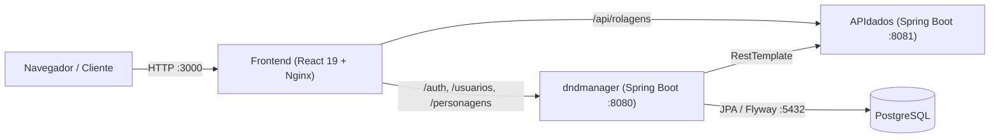

# 🐉 DnD Hub — Ecossistema de Microsserviços com Kubernetes & GitOps

Plataforma full-stack para criação e gerenciamento de fichas de personagens de **Dungeons & Dragons (5e / 5.5e)**, construída com arquitetura de microsserviços containerizados, orquestração em **Kubernetes** e entrega contínua baseada em **GitOps (ArgoCD)**.

---

## 🏗️ Arquitetura do Projeto

O ecossistema é dividido em três serviços independentes que se comunicam dentro do cluster Kubernetes:



| Serviço | Stack | Porta | Responsabilidade |
| :--- | :--- | :---: | :--- |
| **`frontend`** | React 19, Vite, Bootstrap 5, Nginx | `3000` (LB) $\rightarrow$ `80` | Interface SPA e Reverse Proxy para as APIs internas |
| **`dndmanager`** | Java 25, Spring Boot 4, Security (JWT), Flyway | `8080` | Autenticação, regras de domínio, persistência de usuários e fichas |
| **`APIdados`** | Java 25, Spring Boot 4 | `8081` | Motor de rolagem de atributos (`4d6 drop lowest`) |

---

## 🛠️ Stack & Práticas Aplicadas

- **Backend:** Java 25, Spring Boot 4.1, Spring Security + JWT (Stateless), Spring Data JPA, Flyway Migrations, Bean Validation, OpenAPI/Swagger.
- **Frontend:** React 19, Vite, Bootstrap 5, CSS customizado, Axios com interceptores JWT.
- **Containers:** Dockerfiles com *Multi-Stage Build* e execução com usuário *non-root*.
- **Orquestração & Rede:** Kubernetes (`Deployment` com 2 réplicas por serviço, `LoadBalancer`, `Liveness` / `Readiness Probes`, limites de memória JVM com `MaxRAMPercentage`) e Nginx como Reverse Proxy.
- **GitOps:** Sincronização declarativa do cluster via **ArgoCD**.

---

## 🚀 Como Baixar e Rodar

### Pré-requisitos
- [Git](https://git-scm.com/)
- [Docker Desktop](https://www.docker.com/products/docker-desktop/) (com **Kubernetes** habilitado para o modo K8s)
- `kubectl` instalado e apontando para o seu cluster local
- **PostgreSQL** rodando localmente na porta `5432` com um banco chamado `dndmanager` criado *(as tabelas são criadas automaticamente pelo Flyway na primeira execução)*

---

### 1. Clonar o repositório

```bash
git clone https://github.com/SEU-USUARIO/SEU-REPOSITORIO.git
cd SEU-REPOSITORIO
```

---

### 2. Subir no Kubernetes (Recomendado)

#### Passo 1: Build das imagens Docker locais
```bash
docker build -t apidados:1.0.0 ./APIdados
docker build -t dndmanager:1.0.0 ./dndmanager
docker build -t frontend:2.0.0 ./frontend
```

#### Passo 2: Criar o Secret com suas credenciais no cluster
> **Importante:** Nunca versionamos senhas no Git. Crie o `Secret` diretamente no seu cluster substituindo pelos seus dados locais:

```powershell
kubectl create secret generic dndmanager-secret `
  --from-literal=db-url="jdbc:postgresql://host.docker.internal:5432/dndmanager" `
  --from-literal=db-username="postgres" `
  --from-literal=db-password="SUA_SENHA_POSTGRES" `
  --from-literal=jwt-secret="SUA_CHAVE_SECRETA_JWT_MINIMO_32_CHARS" `
  --dry-run=client -o yaml | kubectl apply -f -
```

#### Passo 3: Aplicar os manifestos Kubernetes
```bash
kubectl apply -f APIdados/
kubectl apply -f dndmanager/
kubectl apply -f frontend/
```

#### Passo 4: Verificar os Pods e acessar
```bash
kubectl get pods
```
Com todos os pods em `Running`, acesse no navegador:
- **Aplicação Web (Frontend):** `http://localhost:3000`
- **Swagger UI (Backend):** `http://localhost:8080/swagger-ui/index.html`

---

### 3. Alternativa: Subir com Docker Compose

1. Copie os arquivos de exemplo e preencha suas variáveis locais:
   ```bash
   cp .env.example .env
   ```
2. Suba todos os serviços (inclui um container PostgreSQL pronto):
   ```bash
   docker compose up -d --build
   ```
3. Acesse em `http://localhost:3000`.

---

## 📁 Estrutura do Repositório

```text
├── APIdados/          # Microsserviço de rolagens (Dockerfile + manifestos K8s)
├── dndmanager/        # Core API Spring Boot + Flyway (Dockerfile + manifestos K8s)
├── frontend/          # SPA React + Nginx Reverse Proxy (Dockerfile + manifestos K8s)
├── compose.yaml       # Orquestração local opcional via Docker Compose
├── .env.example       # Modelo de variáveis de ambiente
└── .gitignore         # Proteção contra vazamento de segredos e artefatos locais
```

---

## 🗺️ Roadmap / Próximos Passos

- [x] Containerização *multi-stage* dos 3 serviços
- [x] Orquestração em Kubernetes com réplicas, *probes* e controle de recursos
- [x] Integração com ArgoCD para fluxo GitOps
- [ ] **Deploy Canary** *(implementação futura planejada para entrega progressiva de novas versões)*

