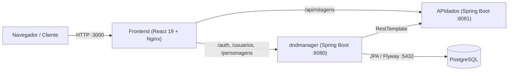

# DnD Hub — Ecossistema de Microsserviços com Kubernetes e GitOps

Plataforma full-stack para criação e gerenciamento de fichas de personagens de **Dungeons & Dragons (5e / 5.5e)**, construída com arquitetura de microsserviços containerizados, orquestração em **Kubernetes** e entrega contínua baseada em **GitOps (ArgoCD)**.

---

## Arquitetura do Projeto

O ecossistema é dividido em três serviços independentes que se comunicam dentro do cluster Kubernetes:



| Serviço | Stack | Porta | Responsabilidade |
| :--- | :--- | :---: | :--- |
| **`frontend`** | React 19, Vite, Bootstrap 5, Nginx | `3000` (LB) -> `80` | Interface SPA e Reverse Proxy para as APIs internas |
| **`dndmanager`** | Java 25, Spring Boot 4, Security (JWT), Flyway | `8080` | Autenticação, regras de domínio, persistência de usuários e fichas |
| **`APIdados`** | Java 25, Spring Boot 4 | `8081` | Motor de rolagem de atributos (`4d6 drop lowest`) |

---

## Material de Apoio e Demonstração

- **Apresentação em Slides (HTML):** [`Kubernetes na prática.html`](https://htmlpreview.github.io/?https://github.com/PseravaT/dnd-hub-k8s-gitops/blob/main/Kubernetes%20na%20pr%C3%A1tica.html) — Simulação interativa de slides usada em aula explicando a evolução do projeto desde a arquitetura inicial até a implementação no Kubernetes. Abra o arquivo diretamente no navegador para visualizar.
- **Demonstração em Vídeo (YouTube):** [RollingUpdate e Rollback na prática](https://youtu.be/dflSJ6n8yJg) — Vídeo demonstrando o funcionamento de atualização contínua (`RollingUpdate`) e reversão de versão (`Rollback`) no cluster Kubernetes.

---

## Stack e Práticas Aplicadas

- **Backend:** Java 25, Spring Boot 4.1, Spring Security + JWT (Stateless), Spring Data JPA, Flyway Migrations, Bean Validation, OpenAPI/Swagger.
- **Frontend:** React 19, Vite, Bootstrap 5, CSS customizado, Axios com interceptores JWT.
- **Containers:** Dockerfiles com *Multi-Stage Build* e execução com usuário *non-root*.
- **Orquestração e Rede:** Kubernetes (`Deployment` com 2 réplicas por serviço, `LoadBalancer`, `Liveness` / `Readiness Probes`, limites de memória JVM com `MaxRAMPercentage`) e Nginx como Reverse Proxy.
- **GitOps:** Sincronização declarativa do cluster via **ArgoCD**.

---

## Como Baixar e Rodar

### Pré-requisitos
- [Git](https://git-scm.com/)
- [Docker Desktop](https://www.docker.com/products/docker-desktop/) (com **Kubernetes** habilitado para o modo K8s)
- `kubectl` instalado e apontando para o seu cluster local
- **PostgreSQL** rodando localmente na porta `5432` com um banco chamado `dndmanager` criado *(as tabelas são criadas automaticamente pelo Flyway na primeira execução)*

---

### 1. Clonar o repositório

```bash
git clone https://github.com/PseravaT/dnd-hub-k8s-gitops.git
cd dnd-hub-k8s-gitops
```

---

### 2. Subir no Kubernetes (Recomendado)

> **Dica para recriação do cluster do zero:** caso você reinicie/resete o Kubernetes do Docker Desktop, as imagens locais já estarão no Docker da sua máquina (se não tiver apagado), mas os objetos do cluster (`Secret`, namespace `argocd` e `Applications`) são apagados. Basta seguir os passos abaixo para subir tudo novamente.

#### Passo 1: Build das imagens Docker locais
```bash
docker build -t apidados:1.0.0 ./APIdados
docker build -t dndmanager:1.0.0 ./dndmanager
docker build -t frontend:3.0.0 ./frontend
```

#### Passo 2: Criar o Secret com suas credenciais no cluster
> **Importante:** Nunca versionamos senhas no Git. Crie o `Secret` diretamente no seu cluster substituindo pelos seus dados locais (mesmo usando ArgoCD, este `Secret` precisa existir antes dos pods do `dndmanager` subirem):

```powershell
kubectl create secret generic dndmanager-secret `
  --from-literal=db-url="jdbc:postgresql://host.docker.internal:5432/dndmanager" `
  --from-literal=db-username="postgres" `
  --from-literal=db-password="SUA_SENHA_POSTGRES" `
  --from-literal=jwt-secret="SUA_CHAVE_SECRETA_JWT_MINIMO_32_CHARS" `
  --dry-run=client -o yaml | kubectl apply -f -
```

#### Passo 3: Subir os serviços no cluster

Escolha uma das duas abordagens abaixo:

##### Opção A — Via GitOps com ArgoCD (Recomendado)

1. **Instale o ArgoCD no cluster** *(pule este passo se o namespace `argocd` já existir)*:
   ```bash
   kubectl create namespace argocd
   kubectl apply -n argocd -f https://raw.githubusercontent.com/argoproj/argo-cd/stable/manifests/install.yaml
   ```
   Aguarde todos os pods do ArgoCD ficarem em `Running`:
   ```bash
   kubectl get pods -n argocd
   ```

2. **Aplique o projeto e as Applications declarativas do ArgoCD:**
   ```bash
   kubectl apply -f argocd/project.yaml
   kubectl apply -f argocd/
   ```
   A partir desse momento, **você não precisa rodar `kubectl apply` nas pastas dos serviços**: o próprio ArgoCD lê os manifestos no GitHub (`APIdados/`, `dndmanager/` e `frontend/`) e cria todos os `Deployments` e `Services` automaticamente no namespace `default`.

3. **Acesse o painel do ArgoCD:**
   - Caso o `argocd-server` não esteja exposto diretamente em `https://localhost:8443/`, faça o encaminhamento de porta:
     ```bash
     kubectl port-forward svc/argocd-server -n argocd 8443:443
     ```
   - Acesse `https://localhost:8443/` com o usuário `admin`.
   - Para obter a senha inicial gerada pelo cluster:
     ```powershell
     # PowerShell
     [System.Text.Encoding]::UTF8.GetString([System.Convert]::FromBase64String((kubectl -n argocd get secret argocd-initial-admin-secret -o jsonpath="{.data.password}")))
     ```
     ```bash
     # Bash (Linux/macOS/Git Bash)
     kubectl -n argocd get secret argocd-initial-admin-secret -o jsonpath="{.data.password}" | base64 -d
     ```

##### Opção B — Deploy direto sem ArgoCD

```bash
kubectl apply -f APIdados/
kubectl apply -f dndmanager/
kubectl apply -f frontend/
```

#### Passo 4: Verificar os Pods e acessar
```bash
kubectl get pods
kubectl get applications -n argocd
```
Com os pods em `Running` (e as aplicações no ArgoCD em `Synced` / `Healthy`), acesse no navegador:
- **Aplicação Web (Frontend):** `http://localhost:3000`
- **Swagger UI (Backend):** `http://localhost:8080/swagger-ui/index.html`
- **Painel GitOps (ArgoCD):** `https://localhost:8443/`

---

## Fluxo GitOps com ArgoCD

Neste repositório, a pasta `argocd/` define de forma declarativa tudo o que o ArgoCD deve gerenciar:

| Manifesto | Tipo (`kind`) | Responsabilidade |
| :--- | :--- | :--- |
| `argocd/project.yaml` | `AppProject` | Define o projeto `dnd-hub`, restringindo a origem permitida ao repositório GitHub oficial e os namespaces de destino (`default` e `argocd`). |
| `argocd/apidados-app.yaml` | `Application` | Monitora `APIdados/` (`deployment.yaml` e `service.yaml`) na branch `main`. |
| `argocd/dndmanager-app.yaml` | `Application` | Monitora `dndmanager/` (`deployment.yaml` e `service.yaml`) na branch `main`. |
| `argocd/frontend-app.yaml` | `Application` | Monitora `frontend/` (`deployment.yaml` e `service.yaml`) na branch `main`. |

Comportamentos configurados nas três `Applications`:
- **Auto-Sync (`automated`):** qualquer `git push` na branch `main` que altere manifestos (como versão de imagem ou número de réplicas) é aplicado automaticamente no cluster.
- **Self-Heal (`selfHeal: true`):** alterações manuais feitas direto no cluster via `kubectl` fora do Git são revertidas automaticamente pelo ArgoCD para manter o Git como fonte única da verdade.
- **Prune (`prune: true`):** recursos removidos do Git também são removidos do cluster.
- **Filtro de arquivos (`directory.include`):** garante que o ArgoCD leia apenas `deployment.yaml` e `service.yaml`, ignorando arquivos como `package.json` no diretório `frontend/`.
- **Segurança de segredos:** o `dndmanager-secret` permanece fora do Git e é criado manualmente no cluster antes da sincronização.

---

### 3. Alternativa: Subir com Docker Compose

1. Copie o arquivo de exemplo e preencha suas variáveis locais:
   ```bash
   cp .env.example .env
   ```
2. Suba os três serviços da aplicação (conectando ao PostgreSQL local na porta 5432):
   ```bash
   docker compose up -d --build
   ```
3. Acesse em `http://localhost:3000`.

---

## Estrutura do Repositório

```text
├── APIdados/                      # Microsserviço de rolagens (Dockerfile + manifestos K8s)
├── argocd/                        # Manifestos declarativos GitOps (AppProject + Applications)
├── dndmanager/                    # Core API Spring Boot + Flyway (Dockerfile + manifestos K8s)
├── frontend/                      # SPA React + Nginx Reverse Proxy (Dockerfile + manifestos K8s)
├── Kubernetes na prática.html     # Apresentação em slides sobre o projeto e Kubernetes
├── compose.yaml                   # Orquestração local opcional via Docker Compose
├── .env.example                   # Modelo de variáveis de ambiente
└── .gitignore                     # Proteção contra vazamento de segredos e artefatos locais
```

---

## Roadmap / Próximos Passos

- [x] Containerização *multi-stage* dos 3 serviços
- [x] Orquestração em Kubernetes com réplicas, *probes* e controle de recursos
- [x] Integração com ArgoCD para fluxo GitOps
- [ ] **Deploy Canary** *(implementação futura planejada para entrega progressiva de novas versões)*
